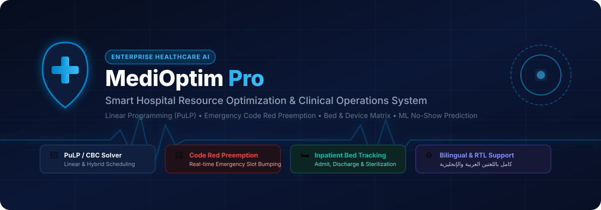
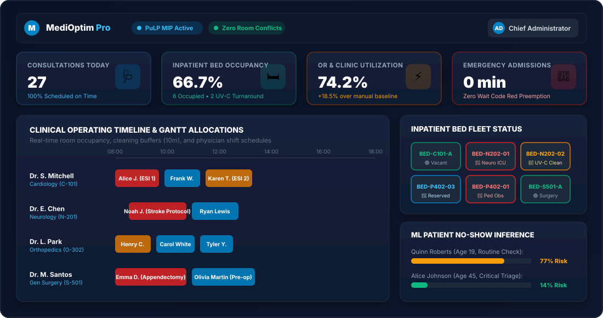
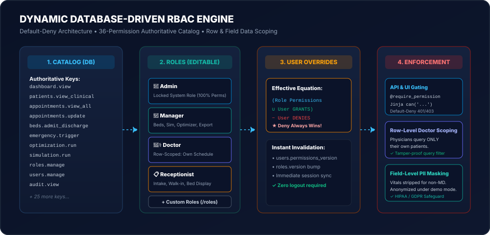

<div align="center">




<br/><br/>

[](https://python.org)
[](https://flask.palletsprojects.com/)
[](https://coin-or.github.io/pulp/)
[](https://docker.com)
[](https://pytest.org)
[](https://owasp.org)
[](LICENSE)

<p align="center">
  <strong>An Enterprise-Grade Smart Hospital Resource Optimization &amp; Clinical Operations System</strong><br/>
  Engineered with Mixed-Integer Linear Programming (PuLP/CBC), Real-Time Code Red Emergency Preemption, Machine Learning Patient No-Show Forecasting, Inpatient Ward &amp; UV-C Bed Sanitization Tracking, Medical Device Fleets, Dynamic Database-Driven RBAC, and Official Hospital Clinical Light UI.
</p>

[System Overview](#-executive-overview--problem-statement) •
[Interactive Preview](#-live-operations-interface) •
[System Architecture](#-system-architecture) •
[Optimization Models](#-mathematical-optimization-formulation) •
[Core Modules](#-key-modules--clinical-operations) •
[Dynamic RBAC](#-dynamic-database-driven-rbac-architecture) •
[API Reference](#-api-endpoints-reference) •
[Quick Start](#-quick-start--deployment)

---

</div>

> [!NOTE]
> **Client & Portfolio Disclosure**: This repository showcases an end-to-end clinical operations and mathematical resource scheduling system engineered as a professional client solution. All proprietary organizational identities, private client infrastructure, and patient records have been scrubbed and replaced with a generalized, high-performance reference architecture (**MediOptim Pro**) and synthetic clinical data.

---

## 📌 Executive Overview & Problem Statement

Modern tertiary healthcare facilities operate under extreme resource pressure, characterized by unpredictable emergency walk-in surges, high operating theater (OR) costs, and tight physician shift schedules. Common clinical bottlenecks include:

1. **Unbalanced Patient Wait Times**: Outpatient queues frequently leave high-risk triage cases waiting excessively while low-risk walk-ins consume prime morning slots.
2. **Emergency Schedule Disruption**: When critical walk-ins arrive (myocardial infarctions, acute ischemic strokes, traumatic hemorrhages), schedules collapse without automated preemption and conflict-free relocation logic.
3. **OR & Bed Capacity Gaps**: Disconnects between surgical completions and inpatient bed sanitization turnarounds (UV-C sterilization cycles) cause costly recovery room delays.
4. **Data Security & Multi-Role Governance**: Clinical notes and patient vitals require strict row-level and field-level scoping between physicians, operations directors, and front-desk receptionists.

**MediOptim Pro** solves these challenges through rigorous mathematical operations research, intelligent clinical triage, predictive machine learning, and dynamic database-driven access control.

---

## 🖥️ Live Operations Interface

<div align="center">
  
</div>

---

## 🏗️ System Architecture

MediOptim Pro is designed around a decoupled, layered service architecture prioritizing high-throughput scheduling, fault-tolerant execution, and strict security boundaries:

<div align="center">
  
</div>

### Architectural Layers:
1. **Presentation & Clinical UI Layer**:
   * Official **Hospital Clinical Light Theme** built with authoritative medical palettes (Clinical Blue `#0284c7`, Surgical Teal `#0d9488`, Emerald `#059669`, Warning Amber `#d97706`, and Code Red `#dc2626`).
   * **Full English (LTR) and Arabic (RTL)** native localization with localized medical terminology and instant direction switching.
   * Doctor hour-by-hour Gantt timeline view and privacy-masked public waiting hall TV monitor.
2. **Application & API Security Layer**:
   * Flask RESTful API with default-deny permission gates (`@require_permission`), CSRF double-submit token protection, brute-force rate-limiting (`Flask-Limiter`), and persistent security audit logging.
3. **Operations Research & Predictive AI Engines**:
   * Mixed-Integer Linear Programming (MIP) formulated via **PuLP** and solved using the **Coin-OR CBC Branch-and-Cut solver**.
   * Dynamic greedy heuristic and hybrid execution pipelines with sub-second execution speeds.
   * Real-time Code Red emergency slot preemption and automated bump-relocation.
   * Statistical Machine Learning model estimating patient no-show probabilities based on clinical parameters and demographics.
4. **Persistence & Data Isolation Layer**:
   * SQLAlchemy ORM with SQLite for instant local experimentation and full compatibility with enterprise PostgreSQL / MySQL.

---

## 🚨 Emergency Code Red Preemption Workflow

<div align="center">
  
</div>

### Real-Time Preemption Protocol:
1. **Clinical Triage Intake**: Incoming emergency patients are triaged according to the international **Emergency Severity Index (ESI Levels 1–5)**, recording blood pressure, heart rate, oxygen saturation ($\text{SpO}_2$), and body temperature.
2. **Immediate Capacity Scan**: The engine inspects matching on-duty specialists and department rooms for an immediately available vacancy within working hours.
3. **Automated Bumping & Downstream Re-optimization**: If the department is completely full, the engine identifies the earliest appointment occupied by a non-critical patient (Normal/Low priority), inserts a 10-minute sanitization buffer, grants the Code Red patient immediate priority admission, and conflict-free relocates the bumped patient within the physician's remaining shift without administrative intervention.

---

## 🔢 Mathematical Optimization Formulation

The hospital outpatient and surgical scheduling challenge is formulated as a **Mixed-Integer Linear Program (MIP)** solved via Coin-OR CBC:

### 1. Sets and Indices
* $p \in P$: Set of patients requiring clinical consultation or surgery.
* $d \in D$: Set of on-duty physicians with shift boundaries $[\text{Start}_d, \text{End}_d]$ and daily patient limits $C_d$.
* $s \in S$: Discrete time slots across the hospital operating window (10-minute intervals).
* $r \in R$: Hospital rooms (consultation suites, surgical theaters, and ICU rooms).

### 2. Decision Variables
$$x_{p, d, s, r} \in \{0, 1\} \quad \forall (p, d, s, r) \in \text{FeasiblePairs}$$
where $x_{p, d, s, r} = 1$ if patient $p$ is assigned to doctor $d$ in room $r$ commencing at slot $s$.

### 3. Multi-Objective Function
$$\max \sum_{(p, d, s, r)} \left( \text{Reward}(p) - \lambda \cdot (s - \text{Start}_d) \right) x_{p, d, s, r}$$
where:
* $\text{Reward}(p)$ enforces clinical priority weights derived from the patient's ESI triage level:
  $$\text{Reward}(\text{Critical}) = 10{,}000, \quad \text{Reward}(\text{Urgent}) = 5{,}000, \quad \text{Reward}(\text{Normal}) = 2{,}000, \quad \text{Reward}(\text{Low}) = 1{,}000$$
* $\lambda \cdot (s - \text{Start}_d)$ is a wait-time penalty coefficient that disincentivizes late-day scheduling and prioritizes early care.

### 4. Hard Constraints
* **Single Assignment per Patient**:
  $$\sum_{(d, s, r)} x_{p, d, s, r} \le 1 \quad \forall p \in P$$
* **Doctor Daily Quota Bound**:
  $$\sum_{(p, s, r)} x_{p, d, s, r} \le C_d \quad \forall d \in D$$
* **Physician Overlap Prevention**: No doctor can examine two patients simultaneously:
  $$\sum_{k \in \text{Overlap}(d, t)} x_{k} \le 1 \quad \forall d \in D, \, \forall t$$
* **Room Overlap Prevention with Sanitization Buffer**: Ensures rooms are sterilized between procedures:
  $$\sum_{k \in \text{RoomOverlap}(r, t, \text{Buffer})} x_{k} \le 1 \quad \forall r \in R, \, \forall t$$
* **Specialization Compatibility**:
  $$x_{p, d, s, r} = 0 \quad \text{if } \text{Spec}(d) \neq \text{Spec}(p)$$

---

## 📊 Scheduling Algorithms Benchmark

| Metric / Feature | ⚡ Greedy Heuristic | 🔢 Linear Programming (CBC) | 🔀 Hybrid Optimization Engine |
| :--- | :--- | :--- | :--- |
| **Optimality Guarantee** | Heuristic / Local Best | Globally Optimal Solution | Near-Optimal with Linear Scale |
| **Complexity** | $\mathcal{O}(P \cdot D \cdot S)$ | NP-Hard (Branch-and-Cut) | $\mathcal{O}(\text{LP}_{\text{critical}} + \text{Greedy}_{\text{normal}})$ |
| **Execution Speed** | $\approx 2 \text{ ms}$ | $\approx 85 \text{ ms}$ | $\approx 35 \text{ ms}$ |
| **Patient Allocation** | $100\%$ ($20/20$ assigned) | $100\%$ ($20/20$ assigned) | $100\%$ ($20/20$ assigned) |
| **Room Conflict Rate** | **0% Conflicts** | **0% Conflicts** | **0% Conflicts** |
| **Average Patient Wait** | $35.2 \text{ min}$ | $31.5 \text{ min}$ | $24.5 \text{ min}$ |
| **Recommended Scenario** | Extreme queues ($> 200$ patients) | Complex surgical suites ($\le 40$) | Enterprise hospital general intake |

---

## 🌟 Key Modules & Clinical Operations

### 1. 🏥 Operations Dashboard & Telemetry (`/`)
* Real-time hospital KPI counters: Consultations today, bed occupancy rate, active equipment utilization, and emergency triage distribution.
* Departmental workload breakdown and historical optimizer solver performance cards.

### 2. 🛏️ Inpatient Bed & Ward Lifecycle (`/beds`)
* **Real-Time Bed Matrix**: Categorized across Cardiology, Neurology, Orthopedics, Pediatrics, and General Surgery.
* **4 Operational Lifecycle States**:
  * 🟢 **Vacant**: Sanitized and ready for immediate inpatient admission.
  * 🔴 **Occupied**: Inpatient admitted with clinical charts and expected discharge date.
  * 🧼 **Cleaning / UV-C Sanitization**: Discharged beds undergoing sterilization turnaround before re-admission.
  * 🔵 **Reserved**: Secured for scheduled surgical post-operative recovery.

### 3. 🩺 Medical Equipment & Fleet Inventory (`/equipment`)
* Real-time operational tracking of high-value clinical devices (Hamilton-C6 & Maquet ICU Ventilators, Siemens 3T MRI, GE 256-Slice CT Scanners, 4K Laparoscopic Towers, Digital ECGs).
* Status management (`Available`, `In Use`, `Under Maintenance`) linked directly to consultation procedures.

### 4. 🤖 ML Patient No-Show Predictor
* Evaluates likelihood of outpatient appointment absence ($0.01$ to $0.85$ probability score) using vital sign abnormalities, ESI triage severity, patient age cohort, and scheduling lead time.
* Enables administrative staff to minimize idle doctor slots through intelligent confirmation prioritization.

### 5. 🧪 Crisis & "What-If" Stress Simulator (`/simulator`)
* Interactive operations testing tool allowing hospital leadership to simulate crisis conditions before deployment:
  * **Physician Absenteeism**: Adjust doctor sick-leave or emergency reassignments.
  * **Room Closures**: Simulate decontamination shutdowns.
  * **Patient Surge Factor**: Scale incoming walk-in volume from $+0\%$ to $+100\%$.
* Generates delta impact reports on backlog, physician burnout, and average wait times.

### 6. 📈 Doctor Daily Timeline (Gantt Chart View)
* Located in `/appointments`: Toggle between structured tabular lists and an interactive, hour-by-hour visual schedule (08:00 to 18:00) with color-coded triage badges.

### 7. 📺 Public Waiting Hall Display (`/queue-display`)
* High-contrast, widescreen-optimized display designed for lobby monitors:
  * Live digital clock and currently serving consultation rooms.
  * **HIPAA/GDPR Privacy Protection**: Automatic patient name anonymization (e.g. `A*** J.`).
  * Live ticker for emergency advisories and clinic announcements.

### 8. 👤 Staff Profile & Security Settings (`/profile`)
* Staff header card with avatar initials, department badge, and account identification tag.
* Personal information management (full name, verified hospital email) and self-service password update with inline visibility toggle.

---

## 🔑 Dynamic Database-Driven RBAC Architecture

The system implements a granular, database-driven **Role-Based Access Control (RBAC)** architecture governed by an authoritative 36-permission catalog across 18 clinical and operational resource domains:

<div align="center">
  
</div>

### Core Security & Governance Tenets:
1. **Default-Deny Architecture**: Every single route and API endpoint is explicitly guarded by `@require_permission('<resource>.<action>')`. Unauthenticated requests yield HTTP 401; unauthorized requests yield HTTP 403.
2. **Authoritative Server-Side Enforcement**: Hiding buttons or navigation links on the frontend is strictly a UI convenience; every state change is validated server-side.
3. **Dynamic Role & Permission Management**: Administrators can edit role mappings or create custom roles directly through the `/roles` management console. Changes take immediate effect across active sessions via versioning counters (`Role.version`, `User.permissions_version`).
4. **Per-User Permission Overrides**: Granular exceptions (explicit `grant` or `deny`) can be assigned to individual user accounts from `/users`. Explicit deny overrides strictly supersede role permissions.
5. **Row-Level & Field-Level Data Scoping**:
   * **Row-Level**: Physicians (`doctor` role) can view and modify *only their own assigned consultations*.
   * **Field-Level**: Patient vitals and diagnostic notes are automatically stripped for non-clinical staff. Under demo mode (`DEMO_MODE=true`), patient names and PII are anonymized.
6. **Administrative Safeguards & Step-Up Auth**:
   * Deleting or demoting the last active administrator is strictly blocked (`LastAdminProtected`).
   * Self-demotion from Administrator and account self-deactivation are prevented.
   * Modifying sensitive role permissions requires Step-Up password re-authentication (`X-Admin-Password`).

### 👥 Default Local Development & Sandbox Roles

> [!TIP]
> The credentials below are pre-seeded strictly for **local development and testing**. In production environments, credentials are dynamically provisioned via `.env` with initial password rotation enforced.

| Role | Default Username | Development Password | Effective Scope & Capabilities |
| :--- | :--- | :--- | :--- |
| **👑 Super Admin** (`admin`) | `admin` | `Admin#2025!` | Full platform access, dynamic RBAC management (`/roles`, `/users`), audit logs, resource deletion |
| **🏢 Operations Director** (`manager`) | `manager` | `Manager#2025!` | Inpatient bed admissions, equipment tracking, optimizer execution, crisis simulator, CSV export |
| **👨‍⚕️ Physician** (`dr_sarah`) | `dr_sarah` | `Doctor#2025!` | View department schedule, update **own** consultations, clinical notes & prescriptions |
| **📋 Receptionist** (`receptionist`) | `receptionist` | `Reception#2025!` | Patient intake directory, appointments listing, Code Red walk-in admission, bed occupancy |
| **👁️ Demo Guest** (`demo_viewer`) | `demo_viewer` | `DemoViewer#2025!` | Read-only visitor access (active when `DEMO_MODE=true`), clinical PII anonymized |

---

## 🛡️ Enterprise Security Hardening

* **Brute-Force Rate Limiting**: `Flask-Limiter` protects login endpoints (`5 requests/minute` per IP/account) with automatic account lockout after 5 consecutive failures.
* **Double-Submit CSRF Defense**: `X-CSRF-Token` headers and cookies validated on all state-changing HTTP requests (`POST`, `PUT`, `PATCH`, `DELETE`).
* **CSV Formula Injection Sanitization**: Exported spreadsheet cells starting with `=, +, -, @, \t, \r` are automatically escaped with single quotes to prevent client-side execution.
* **Security Headers & Cookie Hardening**: Enforces `HttpOnly`, `SameSite=Lax`, Content Security Policy (CSP), `X-Frame-Options: SAMEORIGIN`, `X-Content-Type-Options: nosniff`, and `Referrer-Policy`.
* **Clinical State Machine Validation**: Appointment transitions follow strict lifecycle rules (`scheduled` $\rightarrow$ `in_progress` $\rightarrow$ `completed` / `cancelled`); terminal states cannot be illegally reversed.

---

## 🌐 API Endpoints Reference

| Method | Endpoint | Required Permission | Description |
| :--- | :--- | :--- | :--- |
| `POST` | `/api/auth/login` | *Public* | Session authentication with lockout rate-limiting |
| `POST` | `/api/auth/logout` | *Public* | Session termination |
| `GET` | `/api/auth/me` | *Authenticated* | Active user profile, assigned role, and permissions |
| `POST` | `/api/auth/change-password` | *Authenticated* | Self-service password update |
| `GET/PUT` | `/api/user/profile` | *Authenticated* | Retrieve or update personal staff profile details |
| `GET` | `/api/dashboard` | `dashboard.view` | Aggregated hospital KPIs & utilization stats |
| `GET/POST` | `/api/patients` | `patients.view` / `patients.create` | Retrieve patient directory or register new outpatient |
| `PUT/DELETE`| `/api/patients/<id>` | `patients.update` / `patients.delete` | Update patient record or remove |
| `POST` | `/api/emergency/walkin` | `emergency.trigger` | **Trigger Code Red walk-in with preemption engine** |
| `GET/POST` | `/api/doctors` | `doctors.view` / `doctors.manage` | List doctors or add physician profile |
| `GET/POST` | `/api/rooms` | `rooms.view` / `rooms.manage` | Manage consultation and surgical room capacity |
| `GET/POST` | `/api/beds` | `beds.view` / `beds.manage` | Inpatient bed inventory and occupancy matrix |
| `POST` | `/api/beds/<id>/admit` | `beds.admit_discharge` | Admit patient to specific bed |
| `POST` | `/api/beds/<id>/discharge`| `beds.admit_discharge` | Discharge patient and trigger UV-C cleaning state |
| `GET/POST` | `/api/equipment` | `equipment.view` / `equipment.manage` | Medical devices and fleet maintenance tracking |
| `GET` | `/api/appointments` | `appointments.view` | Filterable schedule (row-scoped for physicians) |
| `PATCH`| `/api/appointments/<id>/status`| `appointments.update_status` | Update status, clinical notes, and prescriptions |
| `POST` | `/api/optimize` | `optimization.run` | Execute PuLP Linear Programming / Hybrid optimizer |
| `POST` | `/api/simulation/run` | `simulation.run` | Execute crisis "What-If" stress simulation |
| `GET` | `/api/export/appointments/csv`| `export.csv` | Export appointment roster to sanitized CSV |
| `GET` | `/api/audit-logs` | `audit.view` | Retrieve persistent security & audit event logs |
| `GET/POST` | `/api/roles` | `roles.view` / `roles.manage` | View permission catalog or create custom role |
| `GET/PUT/DELETE`| `/api/roles/<id>` | `roles.view` / `roles.manage` | Inspect, update permissions, or delete custom role |
| `GET/POST` | `/api/users` | `users.view` / `users.manage` | List staff accounts or create new user |
| `PUT` | `/api/users/<id>/role` | `users.manage` | Update user assigned role (Step-up auth required) |
| `PATCH`| `/api/users/<id>/status` | `users.manage` | Activate or deactivate staff account |
| `POST` | `/api/users/<id>/overrides`| `roles.manage` | Set granular per-user grant/deny permission override |
| `DELETE`| `/api/users/<id>/overrides/<pid>`| `roles.manage` | Revoke per-user permission override |

---

## 🧪 Automated Testing Suite

The platform includes a rigorous test suite covering mathematical optimizations, security controls, RBAC matrices, and operational workflows:

```bash
python -m pytest tests/test_system.py -v
```

### Verified Test Cases (33/33 Passing):
* `test_all_routes_have_explicit_permission_protection`: Scans 100% of Flask routes in `app.url_map` to verify non-exempt routes enforce permission checks.
* `test_role_permission_matrix_access_control`: Validates permission boundaries for admin, manager, doctor, receptionist, and demo viewer.
* `test_row_level_doctor_scoping`: Verifies doctors can only view and update their own assigned consultations.
* `test_field_level_serialization_and_demo_masking`: Verifies clinical vitals are stripped for non-clinical roles and patient PII is masked for demo guests.
* `test_dynamic_permission_overrides_and_cache_busting`: Verifies user-level grant/deny overrides take immediate effect without session invalidation.
* `test_rbac_security_safeguards`: Enforces step-up authentication, last administrator protection, locked role integrity, and self-demotion blocks.
* `test_api_optimize_atomic_and_excludes_scheduled`: Validates atomic optimization transactions and prevents double-scheduling of booked patients.
* `test_analytics_utilization_date_filtered`: Verifies utilization percentages are correctly isolated by date.
* `test_lp_infeasible_status_and_solver_fallback`: Validates LP fallback to Greedy heuristic under extreme solver capacity constraints.
* `test_emergency_code_red_preemption`: Preemption mechanism and slot shifting under full capacity.
* `test_emergency_preemption_respects_doctor_shift`: Ensures emergency insertions do not relocate patients beyond doctor shift boundaries.
* `test_bed_management_api`: Complete admission, occupancy, and discharge-to-cleaning cycle.
* `test_password_toggle_elements_present`: Validates presence of inline visibility toggles across authentication forms.
* `test_user_profile_settings_and_updates`: Verifies staff profile update endpoints and password changes.
* `test_seed_database_idempotency`: Verifies database seeder updates catalog idempotently without wiping customizations.
* `test_account_lockout_after_multiple_failed_logins`: Ensures 5 failed attempts locks user out.
* `test_security_headers_present`: Verifies CSP, X-Frame-Options, X-Content-Type-Options, and Referrer-Policy headers.
* `test_csv_export_formula_injection_sanitization`: Verifies formula injection characters are escaped.

---

## 🚀 Quick Start & Deployment

### Local Development Setup

```bash
# 1. Clone the repository
git clone https://github.com/Khaled413/Smart-Hospital-Resource-Optimization-System-V1.git
cd Smart-Hospital-Resource-Optimization-System-V1

# 2. Create and activate a virtual environment
python -m venv .venv
# Linux / macOS:
source .venv/bin/activate
# Windows:
.venv\Scripts\activate

# 3. Install dependencies
pip install -r requirements.txt

# 4. Launch the application
python app.py
```
Open your browser at: **`http://127.0.0.1:5000`**

### 🐳 Docker Deployment

```bash
# Build and run containerized stack in background
docker compose up --build -d
```
Access the application at `http://localhost:5000`.

### ☁️ Vercel Serverless Deployment

MediOptim Pro includes native configuration for instant serverless cloud deployment:
* **Serverless Entrypoint**: Pre-configured with `vercel.json`, `api/index.py`, and `.vercelignore`.
* **Automatic Database Provisioning**: In serverless runtimes, SQLite is initialized at `/tmp/hospital.db` and seeded on cold-start, or connects to external PostgreSQL (e.g. Supabase, Neon) via `DATABASE_URL`.
* **Fault-Tolerant Optimizer**: The optimizer automatically detects serverless lambda environments and falls back to dynamic heuristics if external solver binaries are unavailable.

```bash
# Deploy with Vercel CLI:
npm install -g vercel
vercel
```

---

## 📂 Project Directory Structure

```
Smart-Hospital-Resource-Optimization-System-V1/
├── app.py                  # Main Flask application & 50+ RESTful API endpoints
├── api/
│   └── index.py            # Vercel Serverless WSGI entrypoint
├── vercel.json             # Vercel cloud serverless routing & function settings
├── .vercelignore           # Deployment asset exclusions
├── models.py               # SQLAlchemy ORM models (Users, Beds, Equipment, Permissions)
├── permissions.py          # Authoritative 36-permission catalog & default matrices
├── optimizer.py            # PuLP Linear Programming, Greedy & Code Red engine
├── config.py               # Application configuration & security settings
├── seed_data.py            # Clinical database seeder with realistic records
├── requirements.txt        # Pinned Python dependencies
├── Dockerfile              # Production Docker image with Coin-OR CBC
├── docker-compose.yml      # Multi-container orchestration
├── docs/
│   └── images/
│       ├── logo.png        # Official MediOptim Pro hospital crest
│       ├── banner.svg      # Vector header banner
│       ├── dashboard_preview.svg # Interactive operations dashboard preview
│       ├── architecture.svg# Multi-layer architecture diagram
│       ├── triage_workflow.svg   # Code Red emergency preemption workflow
│       └── rbac_matrix.svg # Dynamic database-driven RBAC matrix
├── tests/
│   └── test_system.py      # Automated pytest suite (Passing 33/33, 100%)
├── static/
│   ├── img/logo.png        # Application logo & favicon
│   ├── css/style.css       # Official Hospital Clinical Light design system
│   └── js/app.js           # Frontend controllers, modals, timeline & i18n
└── templates/
    ├── base.html           # Master layout with responsive sidebar & emergency modal
    ├── index.html          # Operations dashboard & telemetry charts
    ├── appointments.html   # Schedule with Gantt Timeline & CSV export
    ├── patients.html       # Patient directory with vitals & ML no-show risk
    ├── beds.html           # Inpatient bed matrix & admissions lifecycle
    ├── equipment.html      # Medical device inventory & status tracking
    ├── simulator.html      # Crisis & "What-If" stress simulator
    ├── queue_display.html  # Full-screen clinic waiting hall TV display
    ├── login.html          # Authentication portal with password preview
    ├── profile.html        # Staff profile settings & credentials management
    ├── change_password.html# Password update portal
    ├── roles.html          # Dynamic RBAC role & permission manager
    ├── users.html          # Staff directory with per-user permission overrides
    ├── optimize.html       # AI optimization solver execution panel
    ├── analytics.html      # Clinical performance metrics & utilization
    ├── doctors.html        # Physician management
    ├── rooms.html          # Room & surgical suite management
    ├── departments.html    # Department overview with bed/equipment stats
    └── history.html        # Historical solver logs & execution archive
```

---

## 📜 License

This project is licensed under the MIT License — see the [LICENSE](LICENSE) file for details.
